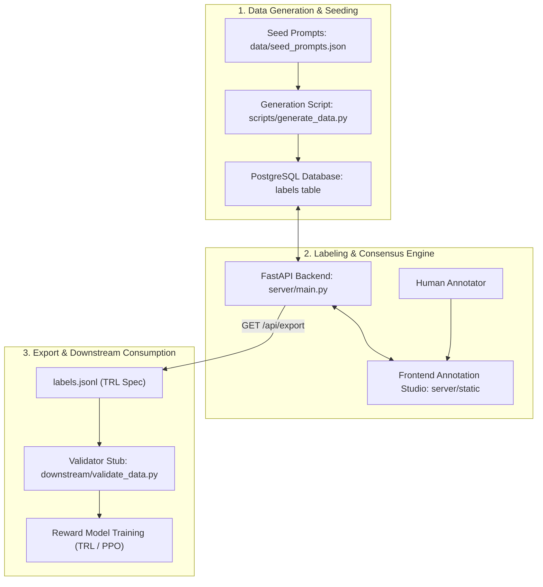

# RLHF Preference Labeling & Data Export Tool

[](https://www.docker.com/)
[](https://fastapi.tiangolo.com/)
[](https://www.postgresql.org/)
[](https://huggingface.co/docs/trl/en/reward_trainer)

A production-grade, full-stack data annotation and export system designed for Reinforcement Learning from Human Feedback (RLHF) pipelines. This tool facilitates the second stage of modern AI alignment: collecting human preference judgments over pairwise LLM responses to train reward models (such as those used in InstructGPT, Claude, and Llama 3).

---

## Table of Contents
1. [Project Overview & RLHF Context](#project-overview--rlhf-context)
2. [System Architecture](#system-architecture)
3. [Key Features](#key-features)
4. [Database Schema](#database-schema)
5. [Quickstart with Docker Compose](#quickstart-with-docker-compose)
6. [Local Development (Without Docker)](#local-development-without-docker)
7. [API Contract Reference](#api-contract-reference)
8. [Downstream Validation Stub](#downstream-validation-stub)
9. [Running Automated Tests](#running-automated-tests)
10. [Configuration & Environment Variables](#configuration--environment-variables)

---

## Project Overview & RLHF Context

Aligning Large Language Models (LLMs) with human intent and safety guidelines is a three-stage process:
1. **Supervised Fine-Tuning (SFT)**: Training base models on high-quality instruction-response pairs.
2. **Reward Model (RM) Training**: Training a model to score responses according to human preferences.
3. **Reinforcement Learning (PPO / DPO)**: Optimizing the policy model against the reward model.

This system provides the end-to-end data pipeline for **Stage 2: Reward Modeling**. Annotators are presented with a prompt and two candidate completions generated under varying temperature settings. The annotator's preference generates a structured triplet: `(prompt, chosen_response, rejected_response)`. The exported dataset is directly compatible with Hugging Face's `TRL` (`RewardTrainer`).

---

## System Architecture



---

## Key Features

- **Pairwise Comparison UI**: Side-by-side display of Prompt, Response A, and Response B with clean typography and category badges.
- **Single-Key Shortcuts**: Ultra-fast labeling using `A` (Choose A), `B` (Choose B), `T` (Tie), and `S` (Skip).
- **Inter-Rater Agreement Analytics**: Computes real-time consensus metrics (pairwise agreement percentage and chance-corrected Cohen's Kappa $\kappa$) across multiple annotator IDs on identical pairs.
- **Category-Aware Pipeline**: Filter both annotation workflows and export streams across 5 core domains: `factual_qa`, `code_generation`, `creative_writing`, `summarization`, and `reasoning`.
- **Standards-Compliant JSONL Export**: Streams `.jsonl` files formatted with `prompt`, `chosen`, `rejected`, and audit `metadata`.
- **Downstream Consumer Validator**: Built-in CLI stub (`downstream/validate_data.py`) simulating pipeline consumption and schema verification.
- **Zero-Dependency SPA**: Self-contained frontend served directly by the backend with no client-side build step required at runtime.

---

## Database Schema

The core table `labels` tracks prompt-response pairs, individual judgments, and annotator assignments:

| Column Name | PostgreSQL Type | Constraints | Description |
|---|---|---|---|
| `id` | `SERIAL` | `PRIMARY KEY` | Unique identifier for each record. |
| `prompt` | `TEXT` | `NOT NULL` | Input instruction or question provided to the LLM. |
| `response_a` | `TEXT` | `NOT NULL` | First candidate completion. |
| `response_b` | `TEXT` | `NOT NULL` | Second candidate completion. |
| `category` | `VARCHAR(255)` | `NOT NULL` | Domain category (e.g. `code_generation`). |
| `annotator_id` | `VARCHAR(255)` | `NULL` | ID of the annotator who provided the preference. |
| `chosen` | `VARCHAR(50)` | `NULL` | Judgment: `'A'`, `'B'`, `'tie'`, `'skip'`, or `NULL`. |
| `created_at` | `TIMESTAMP WITH TZ` | `DEFAULT NOW()` | Timestamp when the pair was generated/seeded. |
| `labeled_at` | `TIMESTAMP WITH TZ` | `NULL` | Timestamp when the annotation was submitted. |
| `pair_id` | `INTEGER` | `NULL` | Foreign reference linking multiple annotator reviews of the same pair. |

---

## Quickstart with Docker Compose

### 1. Prerequisites
- Docker Engine 20.10+
- Docker Compose v2.0+

### 2. Configure Environment
```bash
cp .env.example .env
```

### 3. Launch Services
Start all services (PostgreSQL database and FastAPI application) in detached mode:
```bash
docker-compose up --build -d
```

### 4. Verify Health Checks
Check that both `db` and `app` services report `healthy`:
```bash
docker-compose ps
```
Both services have automated healthchecks configured:
- `db`: Runs `pg_isready -U postgres -d rlhf_db` every 5 seconds.
- `app`: Queries `http://localhost:8000/health` every 5 seconds.

### 5. Access the Application
- **Labeling Studio & Analytics UI**: [http://localhost:8000](http://localhost:8000)
- **Interactive OpenAPI Documentation**: [http://localhost:8000/docs](http://localhost:8000/docs)
- **Direct Dataset Export**: [http://localhost:8000/api/export](http://localhost:8000/api/export)

### 6. Stop Services
```bash
docker-compose down
```

---

## Local Development (Without Docker)

For rapid local testing and development, SQLite is automatically supported as a fallback:

```bash
# 1. Install python dependencies
pip install -r requirements.txt

# 2. Run backend (uses SQLite if DATABASE_URL is not set)
python -m uvicorn server.main:app --host 0.0.0.0 --port 8000 --reload
```

---

## API Contract Reference

### 1. Fetch Next Unlabeled Pair
```http
GET /api/pairs/next?annotator_id={annotator_id}&category={category}
```
**Response (`200 OK`):**
```json
{
  "id": 1,
  "prompt": "What is the capital of France?",
  "response_a": "The capital of France is Paris, located along the Seine River.",
  "response_b": "France's capital city is Lyon, famous for its gastronomy.",
  "category": "factual_qa"
}
```
*Returns `404 Not Found` when all available pairs have been annotated by the user.*

### 2. Submit Preference Label
```http
POST /api/labels
Content-Type: application/json
```
**Request Body:**
```json
{
  "pair_id": 1,
  "annotator_id": "annotator_1",
  "chosen": "A"
}
```
**Response (`201 Created`):**
```json
{
  "status": "success",
  "message": "Label recorded successfully",
  "pair_id": 1,
  "annotator_id": "annotator_1",
  "chosen": "A"
}
```

### 3. Export RLHF Training Dataset
```http
GET /api/export
GET /api/export?category=code_generation
```
**Headers:**
- `Content-Type: application/x-jsonlines`
- `Content-Disposition: attachment; filename="labels.jsonl"`

**Response Body (`200 OK`):**
```jsonlines
{"prompt": "What is the capital of France?", "chosen": "The capital of France is Paris, located along the Seine River.", "rejected": "France's capital city is Lyon, famous for its gastronomy.", "metadata": {"category": "factual_qa", "annotator_id": "annotator_1", "label_id": 1, "pair_id": 1}}
```

### 4. Labeling & Agreement Analytics
```http
GET /api/analytics
```
**Response (`200 OK`):**
```json
{
  "total_labels": 50,
  "label_distribution": {
    "A": 25,
    "B": 15,
    "tie": 8,
    "skip": 2
  },
  "agreement_rate": 0.85,
  "cohens_kappa": 0.82,
  "multi_labeled_pairs_count": 12,
  "category_breakdown": {
    "factual_qa": { "total": 10, "A": 5, "B": 3, "tie": 2, "skip": 0 }
  }
}
```

---

## Downstream Validation Stub

The repository includes a downstream validation consumer script at `downstream/validate_data.py`. It simulates how downstream model training frameworks validate preference data before ingestion into reward trainers:

```bash
# Validate an exported dataset
python downstream/validate_data.py labels.jsonl
```

**Validation Behavior:**
- Parses every line as an independent JSON object.
- Validates the mandatory presence of string keys: `prompt`, `chosen`, and `rejected`.
- Exits with status `0` on success.
- Exits with status `1` and prints line-specific error details if any validation fails.

---

## Running Automated Tests

The test suite validates all 11 contract requirements:
```bash
python -m pytest tests/ -v
```

**Test Coverage Summary:**
- Database initial seeding ($\ge 50$ pairs).
- `.env.example` existence, required variables, and secret protection.
- Schema verification (`labels` table columns and constraints).
- Next pair fetching logic, annotator isolation, and `404` boundary checks.
- Label submission and direct database record verification.
- JSONL format compliance, headers, and category filtering.
- Distribution counts and chance-corrected inter-rater agreement computation.
- Downstream validation script on valid and invalid fixtures.

---

## Configuration & Environment Variables

Documented in `.env.example`:

| Variable | Default Value | Description |
|---|---|---|
| `DATABASE_URL` | `postgresql://postgres:postgres@db:5432/rlhf_db` | Connection string for PostgreSQL or SQLite. |
| `PORT` | `8000` | HTTP port exposed by the application. |
| `OPENAI_API_KEY` | `your_openai_api_key_here` | Optional API key for LLM generation scripts. |
| `LLM_PROVIDER` | `openai` | LLM generation provider (`openai`, `ollama`, or `mock`). |
| `OLLAMA_BASE_URL`| `http://localhost:11434` | Base URL for local Ollama instances. |

---

## License
MIT License. Created as part of the RLHF Data Alignment Program.

